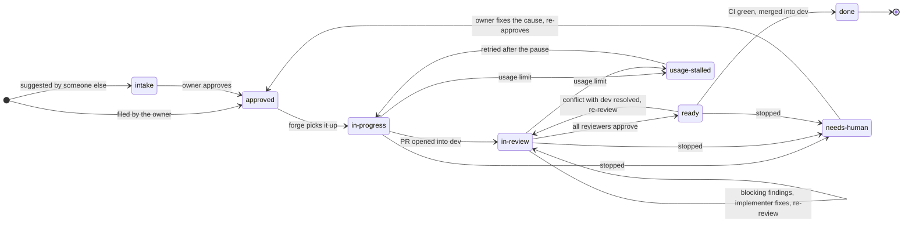
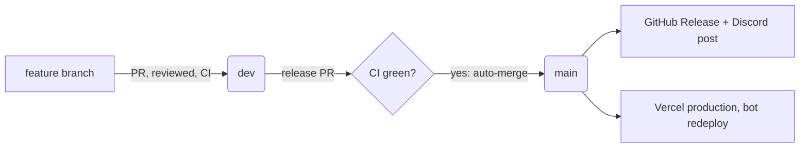

<a href="https://demo-nextjs-with-supabase.vercel.app/">
  
  <h1 align="center">Next.js and Supabase Starter Kit</h1>
</a>

<p align="center">
 The fastest way to build apps with Next.js and Supabase
</p>

<p align="center">
  <a href="#features"><strong>Features</strong></a> ·
  <a href="#demo"><strong>Demo</strong></a> ·
  <a href="#deploy-to-vercel"><strong>Deploy to Vercel</strong></a> ·
  <a href="#clone-and-run-locally"><strong>Clone and run locally</strong></a> ·
  <a href="#feedback-and-issues"><strong>Feedback and issues</strong></a>
  <a href="#more-supabase-examples"><strong>More Examples</strong></a>
</p>
<br/>

## How changes are made

Every change starts as a GitHub issue and is built by **forge**: Claude Code implements,
Codex, Gemini and Muse review, and the PR merges into `dev` once all reviewers approve and CI
is green. `main` is what runs in production (the website on Vercel and the bot).

An issue's state is one label:



| Label | Meaning |
|---|---|
| `intake` | Suggested, not approved yet; nothing runs. |
| `approved` | Queued. Lowest issue number first; `priority` jumps the queue. |
| `in-progress` / `in-review` / `ready` | Being implemented, reviewed, or waiting for CI. |
| `usage-stalled` | An AI agent hit its usage limit; forge retries by itself. |
| `needs-human` | forge stopped; the last `forge stopped` comment on the issue or its PR says why. |
| `done` | Merged into `dev`; reaches production with the next release. |

**Restarting a `needs-human` issue:** fix the cause first (a decision the issue left open
goes into the issue text), *then* add the `approved` label. Editing the text after
approving voids the approval. forge starts again on a new branch; close the old PR.

**Releasing:** a release PR from `dev` into `main` merges itself once CI is green. On merge,
the release notes become a GitHub Release and a post in Discord.



## Numbers

The website uses [Vercel Web Analytics](https://vercel.com/docs/analytics) in production
(cookieless, so no banner; turn it on in the Vercel project's Analytics tab). Member ids are
cut from the URLs it reports; server ids stay. What is tracked and why is also on `/about`.

Metrics to check once a month (Ruben):

| Metric | Where |
|---|---|
| Servers with the bot | `select count(*) from guilds;` |
| Servers with ≥1 site visit per week | Vercel Analytics → Pages, last 7 days: distinct ids among `/s/<id>/...` paths |
| `/setup` completion rate | `select count(*) from guild_settings s join guilds g using (guild_id);` ÷ servers with the bot |
| Recap posts per month | `select month, count(*) from monthly_recaps where posted_at is not null group by 1 order by 1;` |

## Features

- Works across the entire [Next.js](https://nextjs.org) stack
  - App Router
  - Pages Router
  - Proxy
  - Client
  - Server
  - It just works!
- supabase-ssr. A package to configure Supabase Auth to use cookies
- Password-based authentication block installed via the [Supabase UI Library](https://supabase.com/ui/docs/nextjs/password-based-auth)
- Styling with [Tailwind CSS](https://tailwindcss.com)
- Components with [shadcn/ui](https://ui.shadcn.com/)
- Optional deployment with [Supabase Vercel Integration and Vercel deploy](#deploy-your-own)
  - Environment variables automatically assigned to Vercel project

## Demo

You can view a fully working demo at [demo-nextjs-with-supabase.vercel.app](https://demo-nextjs-with-supabase.vercel.app/).

## Deploy to Vercel

Vercel deployment will guide you through creating a Supabase account and project.

After installation of the Supabase integration, all relevant environment variables will be assigned to the project so the deployment is fully functioning.

[](https://vercel.com/new/clone?repository-url=https%3A%2F%2Fgithub.com%2Fvercel%2Fnext.js%2Ftree%2Fcanary%2Fexamples%2Fwith-supabase&project-name=nextjs-with-supabase&repository-name=nextjs-with-supabase&demo-title=nextjs-with-supabase&demo-description=This+starter+configures+Supabase+Auth+to+use+cookies%2C+making+the+user%27s+session+available+throughout+the+entire+Next.js+app+-+Client+Components%2C+Server+Components%2C+Route+Handlers%2C+Server+Actions+and+Middleware.&demo-url=https%3A%2F%2Fdemo-nextjs-with-supabase.vercel.app%2F&external-id=https%3A%2F%2Fgithub.com%2Fvercel%2Fnext.js%2Ftree%2Fcanary%2Fexamples%2Fwith-supabase&demo-image=https%3A%2F%2Fdemo-nextjs-with-supabase.vercel.app%2Fopengraph-image.png)

The above will also clone the Starter kit to your GitHub, you can clone that locally and develop locally.

If you wish to just develop locally and not deploy to Vercel, [follow the steps below](#clone-and-run-locally).

## Clone and run locally

1. You'll first need a Supabase project which can be made [via the Supabase dashboard](https://database.new)

2. Create a Next.js app using the Supabase Starter template npx command

   ```bash
   npx create-next-app --example with-supabase with-supabase-app
   ```

   ```bash
   yarn create next-app --example with-supabase with-supabase-app
   ```

   ```bash
   pnpm create next-app --example with-supabase with-supabase-app
   ```

3. Use `cd` to change into the app's directory

   ```bash
   cd with-supabase-app
   ```

4. Rename `.env.example` to `.env.local` and update the following:

  ```env
  NEXT_PUBLIC_SUPABASE_URL=[INSERT SUPABASE PROJECT URL]
  NEXT_PUBLIC_SUPABASE_PUBLISHABLE_KEY=[INSERT SUPABASE PROJECT API PUBLISHABLE OR ANON KEY]
  ```
  > [!NOTE]
  > This example uses `NEXT_PUBLIC_SUPABASE_PUBLISHABLE_KEY`, which refers to Supabase's new **publishable** key format.
  > Both legacy **anon** keys and new **publishable** keys can be used with this variable name during the transition period. Supabase's dashboard may show `NEXT_PUBLIC_SUPABASE_ANON_KEY`; its value can be used in this example.
  > See the [full announcement](https://github.com/orgs/supabase/discussions/29260) for more information.

  Both `NEXT_PUBLIC_SUPABASE_URL` and `NEXT_PUBLIC_SUPABASE_PUBLISHABLE_KEY` can be found in [your Supabase project's API settings](https://supabase.com/dashboard/project/_?showConnect=true)

5. You can now run the Next.js local development server:

   ```bash
   npm run dev
   ```

   The starter kit should now be running on [localhost:3000](http://localhost:3000/).

6. This template comes with the default shadcn/ui style initialized. If you instead want other ui.shadcn styles, delete `components.json` and [re-install shadcn/ui](https://ui.shadcn.com/docs/installation/next)

> Check out [the docs for Local Development](https://supabase.com/docs/guides/getting-started/local-development) to also run Supabase locally.

## Feedback and issues

Please file feedback and issues over on the [Supabase GitHub org](https://github.com/supabase/supabase/issues/new/choose).

## More Supabase examples

- [Next.js Subscription Payments Starter](https://github.com/vercel/nextjs-subscription-payments)
- [Cookie-based Auth and the Next.js 13 App Router (free course)](https://youtube.com/playlist?list=PL5S4mPUpp4OtMhpnp93EFSo42iQ40XjbF)
- [Supabase Auth and the Next.js App Router](https://github.com/supabase/supabase/tree/master/examples/auth/nextjs)
